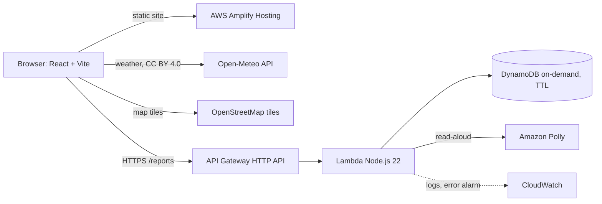

# जलदृष्टि | JalDrishti

**मेरे इलाके में क्या हो रहा है, जानकारी कितनी नई है, और मैं क्या कर सकता हूँ?**
*What's happening on my street, how old is that information, and what can I do?*

**[▶ Live demo](https://main.d3d8k3q572kn9v.amplifyapp.com)** · [Architecture](#architecture) 


-527FFF?logo=amazonaws&logoColor=white)


A Hindi-first map of heat, waterlogging, water leaks and tanker needs in Delhi,
where every item says **where it came from, how old it is, and whether anyone
has confirmed it**. Residents report what they see, neighbours confirm it with
one tap, and anyone can **listen** to it in Hindi. Built by team
**धरती कवच (Dharti Kavach)** for the Bharat Builds Tour, Environmental Hacks
(Heat and Water track), October 2026.

> Prototype. Not an emergency service: in an emergency call **112**.


## How people use it

| Moment | What happens | AWS |
|---|---|---|
| An elderly resident wants to know if it's safe to walk to the market | Taps **🔊 सुनें** and hears the feels-like temperature in Hindi, with "this is a model estimate, not an official warning" and heat advice above 40 °C | Amplify · API Gateway · Lambda · **Polly** |
| A commuter finds an underpass flooded | Picks *जलभराव*, taps the spot on the map, sends. It appears at once as **Unverified · Fresh**, with a server timestamp | API Gateway · Lambda · **DynamoDB** |
| They want neighbours to check it | **WhatsApp पर भेजें** sends a link with a preview card; the link opens straight to that report | Amplify |
| A neighbour on another network sees it too | Taps **मैंने भी देखा**. One response per person, never your own report; two confirmations make it *confirmed by others* and make it fresh again | DynamoDB transactions |
| The water drains away | People tap **अब नहीं है**; after enough of them it shows as *reported resolved* | DynamoDB |
| Nobody confirms it for 7 days | It leaves the map; DynamoDB TTL deletes it after 30 days | DynamoDB TTL |
| Behind the scenes | One JSON log line per request, no IPs or report text; an alarm on errors | **CloudWatch** |

## Try it in 2 minutes

1. Open the **[live demo](https://main.d3d8k3q572kn9v.amplifyapp.com)** (works on a phone).
2. Tap **🔊 सुनें** in the weather panel, or switch to **English** first.
3. **समस्या दर्ज करें** (Report a problem) → pick a category → tap the map → enter an area → send.
4. Open your report → **WhatsApp पर भेजें** → open that link on another phone **on mobile data** → **मैंने भी देखा**.

## What works, what doesn't

| Feature | State |
|---|---|
| Hindi-first UI with English toggle | Working |
| OpenStreetMap map of Delhi (no key needed), category filters, tap-to-pick location, detail panel, list view | Working |
| Weather: temperature, feels-like, humidity, rain, 48 h chart, 6 points across Delhi | Working (Open-Meteo model data, labelled as model, not station readings) |
| Read-aloud in Hindi or English (Amazon Polly) for weather, heat points and reports | Working; server-written sentences only, rate-limited and capped per day |
| Share a report on WhatsApp / by link (`#r=<id>`) so neighbours can confirm it | Working |
| Age-of-information rail (how old each source is) | Working |
| Community reports: submit, list, server timestamps, validation | Working, deployed on AWS |
| Corroboration ("still there" / "gone now"), freshness rules | Working; uses DynamoDB transactions (covered by mocked-SDK tests; live check: deploy guide step 8) |
| Rate limiting, duplicate prevention, idempotent retries | Working, deployed (also tested against a DynamoDB emulator) |
| IMD heat/rain warnings | **Not available**: no public documented API found; shown as unavailable |
| Groundwater levels | **Not available**: no machine-readable per-location source; published Delhi-wide figures conflict between secondary sources, so none is shown |
| Actual tanker availability (DJB) | **Not available**: only resident sightings are shown |
| Photo uploads (S3) | Not built |

## Architecture



AWS services actually used: **API Gateway, Lambda, DynamoDB, CloudWatch,
Amplify Hosting, Polly**, deployed with the **AWS SAM CLI**. Why these and not others: [docs/aws-decisions.md](docs/aws-decisions.md).

### API

| Method | Path | Does |
|---|---|---|
| GET | `/reports` | Reports confirmed in the last 7 days |
| POST | `/reports` | Create a report (validated server-side, server timestamps) |
| POST | `/reports/{id}/signals` | `{"type":"confirm"}` or `{"type":"cleared"}` |
| POST | `/speech` | `{"kind":"report","id":…}` or `{"kind":"heat","point":…,"feelsLike":…}` plus `"lang"`; returns base64 MP3 and the spoken text. No free text accepted |

Single DynamoDB table: `REPORT#id / META` for reports, `REPORT#id / SIGNAL#person`
for one signal per person, `RATE#person / action#window` for rate limits.
`GSI1` lists active reports without a table scan.

### Truthfulness rules

- Community reports are **unverified** by default. No report is ever shown as
  officially verified, because nobody official verifies them.
- A report becomes "confirmed by others" when **2 distinct people** (not the
  reporter) say it's still there. Each confirmation resets its age.
- It shows as "reported resolved" when at least 2 people said it's gone, the
  latest "gone" is newer than the latest "still there", and "gone" ≥ "still there".
- Freshness (from the last confirmation):

  | Category | Fresh for | Stale after |
  |---|---|---|
  | Waterlogging | 3 h | 12 h |
  | Water leak | 24 h | 72 h |
  | Tanker needed | 6 h | 24 h |
  | Tanker supplying | 2 h | 6 h |
  | Other | 24 h | 72 h |

- Reports leave the map after 7 days without confirmation; DynamoDB TTL deletes
  them 30 days after submission.
- An empty map says explicitly that no reports ≠ no problem.
- Weather shows **valid-at time** and **fetched-at time** separately, and the
  model grid cell actually used.

## Data providers

| Provider | Data | Type | Access | Licence / attribution |
|---|---|---|---|---|
| [Open-Meteo](https://open-meteo.com/) | Temperature, apparent temp, humidity, precipitation, rain probability | Model (current ~15-min steps) + forecast | No key; free tier non-commercial, < 10,000 calls/day | CC BY 4.0, credited in UI |
| Residents (this app) | Waterlogging, leaks, tanker need/supply | Community reports | Our API | — |
| [OpenStreetMap](https://www.openstreetmap.org/) | Base map tiles (drawn with Leaflet) | — | No key; [tile usage policy](https://operations.osmfoundation.org/policies/tiles/), light traffic | © OpenStreetMap contributors (ODbL), credited on the map |

## Run locally

Requires **Node.js 22.12 or newer** (Vite 8, Vitest 5 and concurrently need it).
`.npmrc` sets `engine-strict`, so an older Node fails at install with a clear
message instead of leaving a half-installed project.

```bash
npm ci                         # exact versions from package-lock.json
cp .env.example .env.local     # Windows: Copy-Item .env.example .env.local
npm run doctor                 # checks Node, installed packages and .env.local
npm run dev:all                # API on :8787 (in-memory, starts empty) + web on :5173
```

The map uses OpenStreetMap tiles, so it needs no key.
The local API stores reports in memory only and never seeds fake data.

**Windows, after a crash or "concurrently is not recognized":** the install was
interrupted. Stop running dev servers (Ctrl+C), then:
`powershell -ExecutionPolicy Bypass -File scripts\repair-windows.ps1`.

## Scripts

| Command | Does |
|---|---|
| `npm run dev:all` | Local API + website together |
| `npm run doctor` | Diagnoses setup problems, never prints secret values |
| `npm run check` | oxlint + TypeScript (app and backend) + all tests |
| `npm run check:all` | `check` + frontend build + Lambda bundle + Lambda smoke test |
| `npm run build:api` | Bundles the Lambda into `backend/dist/lambda.mjs` |
| `npm run smoke:lambda` | Runs the **built** Lambda with API Gateway events against an in-memory DynamoDB |
| `npm run package:web` | Builds and zips the website for Amplify (`deploy/jaldrishti-web.zip`) |

Tests cover: validation (client and server share one module), freshness and
corroboration rules, report creation/listing/idempotency/near-duplicates/rate
limits, signal rules (no self-confirm, one per person), DynamoDB request shapes
and error mapping (mocked SDK), **integration tests against
[dynalite](https://github.com/architect/dynalite)** (an in-memory
DynamoDB-compatible server: conditional writes, GSI queries, rate-limit
counters), Open-Meteo parsing and provenance, map pins and OpenStreetMap
attribution, source and timestamp rendering, and
loading/empty/error/not-configured states.

Not covered automatically: DynamoDB **transactions** (dynalite doesn't implement
them; check them on real AWS with the deploy guide's checklist), live map
tiles, and live Open-Meteo responses.

## Map

The map is drawn with [Leaflet](https://leafletjs.com/) on
[OpenStreetMap](https://www.openstreetmap.org/) standard tiles: no API key, no
billing, nothing to configure. A CSS filter gives the tiles the site's dark look.

- **Attribution is required** and is shown in the map corner
  ("© OpenStreetMap contributors").
- OpenStreetMap's [tile usage policy](https://operations.osmfoundation.org/policies/tiles/)
  allows light use like a demo or prototype. For real traffic, point `TILE_URL`
  in `src/lib/mapConfig.ts` at a commercial or self-hosted tile server.
- If tiles can't load (offline, blocked network), the map says so and the list
  below it still shows every report.

## Deploy to AWS

**Step-by-step Windows PowerShell guide: [docs/DEPLOY-WINDOWS.md](docs/DEPLOY-WINDOWS.md)**:
tools, `aws login` (no access keys), budget alert, Amplify upload, `sam deploy`,
testing the public URL, logs, troubleshooting, costs and cleanup.

Summary: upload the website to Amplify Hosting (*Deploy without Git*) to get its
domain → `sam deploy` the backend with that domain as `AllowedOrigin` → rebuild
the website with the `ApiUrl` output → upload again.

**Live:** https://main.d3d8k3q572kn9v.amplifyapp.com, in `ap-southeast-2`
(Sydney). The guide says Mumbai (`ap-south-1`), the closest region to Delhi, but
new AWS Free plan accounts are limited to one region, so use the one your
account is assigned (see the guide's troubleshooting table).

## Security and privacy

- No accounts, names, phone numbers or emails are collected.
- Coordinates are rounded to 4 decimals (~11 m).
- For rate limits and "one response per person", the API stores a salted
  SHA-256 hash of IP + user agent + date. It rotates daily, isn't reversible to
  an IP without the secret salt, and is never returned by the API. Known limit:
  this is abuse-resistant, not abuse-proof (shared networks, VPNs, new days).
- All user text is rendered as text (React escaping), never as HTML; control and
  bidi-override characters are stripped.
- Lambda IAM role: only `GetItem, PutItem, UpdateItem, ConditionCheckItem, Query`
  on this table and its index, plus `polly:SynthesizeSpeech`.
- Read-aloud can't be turned into a free text-to-speech service: the server
  writes every sentence, limits each person to 20 plays an hour and the whole
  site to 500 a day (bounding the Polly bill), and caches repeats.
- CORS allows exactly one origin; the template rejects trailing slashes, paths
  and `*`. API Gateway throttles at 10 req/s (burst 20).
- Logs exclude IPs, user agents and report text; 14-day retention (verified on
  the built bundle by `npm run smoke:lambda`).
- Website security headers (`public/customHttp.yml`, applied by Amplify): HSTS,
  `nosniff`, `X-Frame-Options: DENY`, strict referrer policy, permissions policy
  allowing only geolocation.
- `npm audit`: 0 known vulnerabilities (11 Oct 2026).
- The deploy guide signs the CLI in with `aws login` (short-lived credentials);
  no AWS keys exist in the project.

## Known limitations

- Open-Meteo's grid is coarse, so neighbouring points can show similar values.
  It is a model estimate, not a heatwave declaration.
- Corroboration can be gamed by someone switching networks; there is no
  official verification layer.
- Map labels come from OpenStreetMap (mostly English place names) and don't
  change with the Hindi/English toggle.
- No Content-Security-Policy header yet: it needs testing against the live site,
  and an untested one can silently break the map or API calls.
- IMD warnings, groundwater levels and Delhi Jal Board tanker data are not
  integrated (no documented public API found); the app says so instead of guessing.

## Team

**धरती कवच (Dharti Kavach)**: Shambhavi M K

## Licence and credits

MIT License
